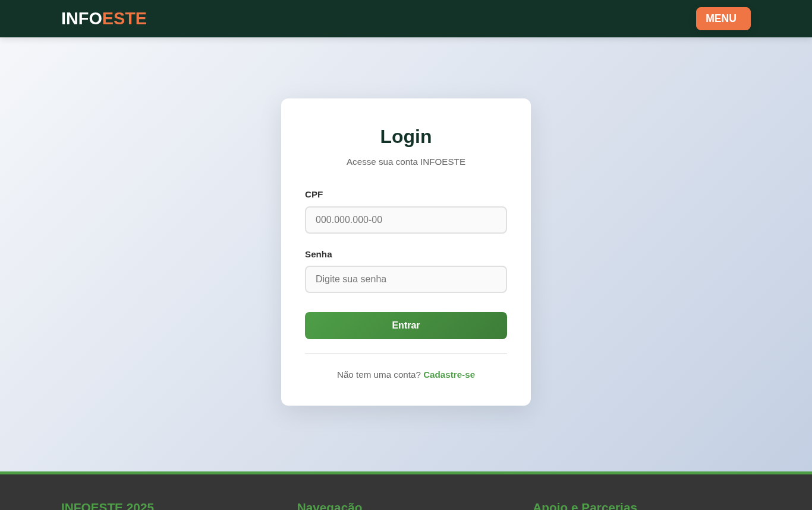
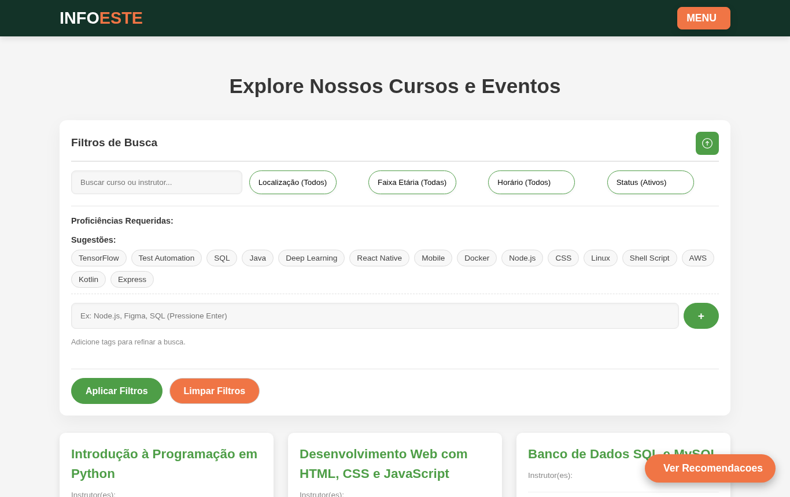
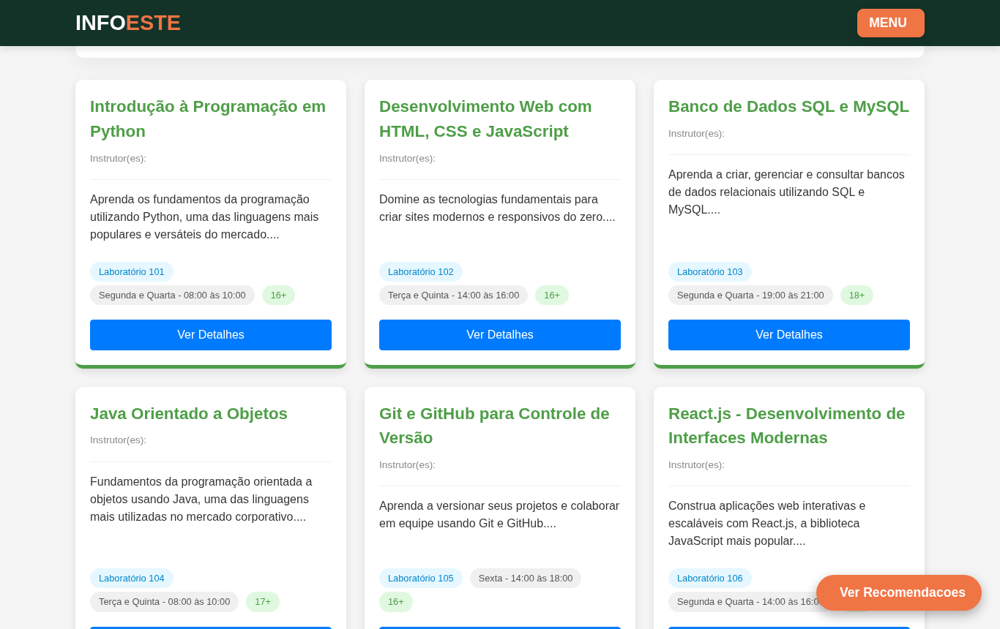
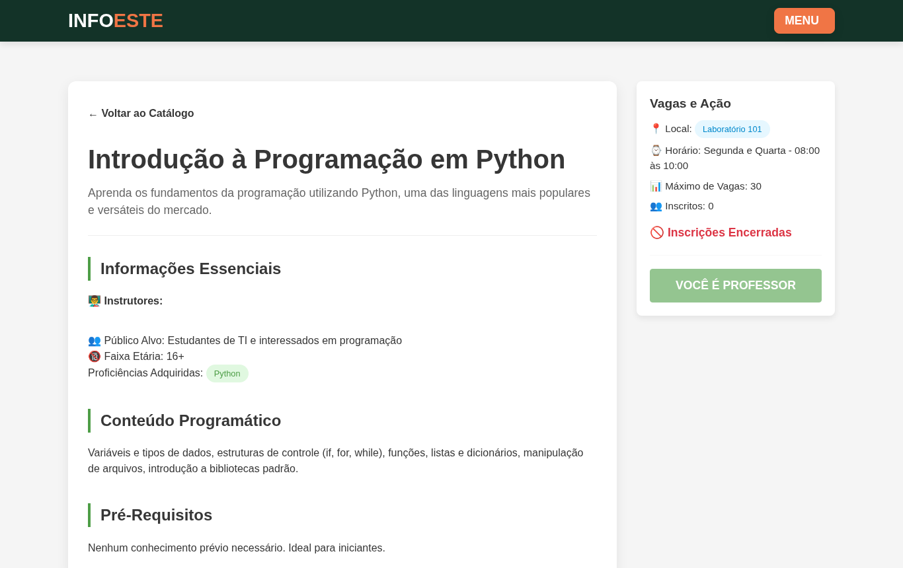
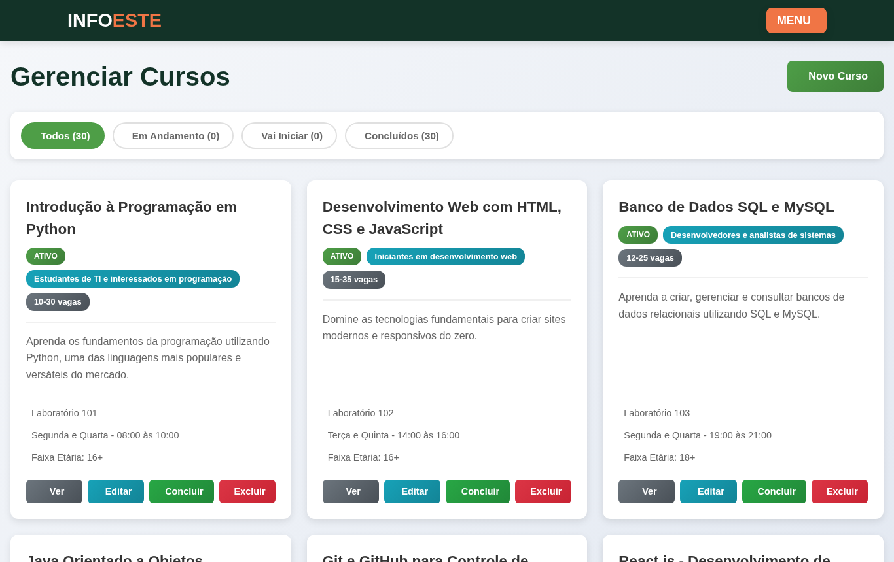
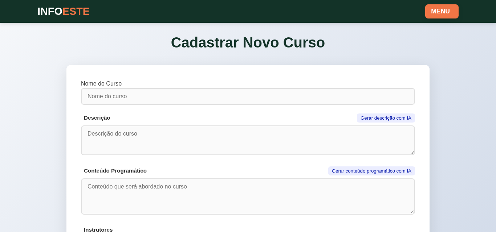

# 🎓 Infoeste v2: Catálogo de Cursos com Recomendações por IA

Aplicação **full stack** para cadastro, gestão e inscrição em cursos de evento, com **recomendações personalizadas e geração de conteúdo usando o Google Gemini**. O repositório reúne o **front-end em Vue 3** e a **API REST em Node.js + Express + MongoDB**.


## 📸 Screenshots

> Capturadas rodando o projeto localmente com os dados de exemplo da pasta `imports/`.

| Login | Catálogo de cursos |
|---|---|
|  |  |

| Cards do catálogo | Detalhes do curso |
|---|---|
|  |  |

| Admin: gerenciar cursos | Admin: novo curso com assistente de IA |
|---|---|
|  |  |

## ✨ Funcionalidades

### 👤 Aluno
- Cadastro e login por **CPF e senha**.
- Perfil editável (nome, e-mail, proficiências e foto enviada em Base64).
- **Catálogo de cursos** com busca, filtros (proficiências, local, faixa etária, horário, status) e paginação.
- **Inscrição** com validação de **pré-requisitos** (proficiências do aluno) e controle de vagas: o status fica **"Inscrito"** ou **"Fila de Espera"**.
- Cancelamento de inscrição e página **"Meus cursos"**.
- **Avaliação** dos cursos.
- **Recomendações por IA**: o Gemini cruza as proficiências do aluno, os pré-requisitos dos cursos e as inscrições atuais para sugerir cursos com uma explicação personalizada.

### 👑 Administrador / professor
- CRUD de **usuários** e de **cursos** (rotas do front protegidas para o nível `admin`).
- **Assistente de IA** no cadastro de curso: gera descrição, conteúdo programático, proficiências, público-alvo e pré-requisitos.
- Marcar curso como concluído, ocultar avaliações e gerar **resumo das avaliações com IA**.
- Ao listar os cursos, os que já passaram da data de término são marcados como **Concluídos** automaticamente e as proficiências do curso são adicionadas ao perfil dos alunos inscritos.

## 🛠️ Tecnologias

| Front-end (`info-front-end-main`) | Back-end (`info-webservice-main`) |
|---|---|
| Vue 3 + Vue Router 4 | Node.js + Express 4 (ES Modules) |
| Bulma, Font Awesome, Sass | MongoDB + Mongoose 8 |
| Axios | Google Gemini (`@google/genai`) |
| Vue CLI 5 | Helmet, CORS, compression, morgan, dotenv |

## 🔌 Endpoints da API

Base: `http://localhost:3000`

| Método | Rota | Descrição |
|---|---|---|
| POST | `/api/auth/cadastro` | Cadastro de usuário |
| POST | `/api/auth/login` | Login (CPF e senha) |
| GET | `/api/users` | Lista usuários |
| GET | `/api/users/professores` | Lista professores |
| GET / PUT / DELETE | `/api/users/:id` | Busca / atualiza / remove usuário |
| POST | `/api/users` | Cria usuário |
| GET | `/api/users/:id/inscricoes` | Cursos em que o usuário está inscrito |
| GET | `/api/cursos` | Lista cursos (filtros e paginação) |
| GET | `/api/cursos/tags` | Tags/proficiências distintas |
| GET | `/api/cursos/instrutor/:instrutorId` | Cursos de um instrutor |
| GET / PUT / DELETE | `/api/cursos/:id` | Busca / atualiza / remove curso |
| POST | `/api/cursos` | Cria curso |
| PATCH | `/api/cursos/:id/concluir` | Marca curso como concluído |
| POST | `/api/inscricoes` | Inscreve usuário em curso |
| GET | `/api/inscricoes/status/:cursoId/:usuarioId` | Status da inscrição |
| GET | `/api/inscricoes/usuario/:usuarioId` | Inscrições do usuário |
| DELETE | `/api/inscricoes/:id` | Cancela inscrição |
| PATCH | `/api/inscricoes/:id/concluir` | Conclui o curso para o aluno |
| POST | `/api/avaliacoes` | Cria avaliação |
| GET | `/api/avaliacoes/curso/:cursoId` | Avaliações de um curso |
| GET | `/api/avaliacoes/verificar/:cursoId/:usuarioId` | Verifica se o usuário já avaliou |
| PATCH | `/api/avaliacoes/:id/ocultar` | Oculta/exibe avaliação |
| POST | `/api/recomendacoes` | Recomendações personalizadas (IA) |
| POST | `/api/gemini` | Chamada genérica ao Gemini |
| POST | `/api/gemini/descricao` | Gera descrição do curso |
| POST | `/api/gemini/proficiencias` | Gera proficiências |
| POST | `/api/gemini/conteudo-programatico` | Gera conteúdo programático |
| POST | `/api/gemini/publico-alvo` | Gera público-alvo |
| POST | `/api/gemini/pre-requisitos` | Gera pré-requisitos |
| POST | `/api/gemini/resumo-avaliacoes` | Gera resumo das avaliações |
| POST | `/api/gemini/recomendacoes` | Recomendações de cursos via Gemini |

## 📁 Estrutura do projeto

```
infoeste-course-platform/
├── info-front-end-main/        # Front-end Vue 3
│   └── src/
│       ├── components/         # NavBar, CursoCard, FiltroCursos, IARecomenda...
│       ├── router/             # Rotas e proteção das páginas de admin
│       ├── services/api.js     # Axios (baseURL http://localhost:3000/api)
│       └── views/              # Login, Catálogo, Detalhes, Perfil, Meus Cursos, Admin...
└── info-webservice-main/       # API REST
    ├── config/db.js            # Conexão MongoDB
    ├── controllers/            # Auth, User, Curso, Inscricao, Avaliacao, Gemini, Recomendacao
    ├── imports/                # Dados de exemplo (cursos.json, usuarios.json)
    ├── middlewares/            # Helmet, compression, morgan...
    ├── models/ + Schemas/      # Modelos Mongoose
    ├── routes/                 # Rotas da API
    ├── services/geminiAPI.js   # Integração com o Gemini
    └── server.js
```

## ▶️ Como executar

Pré-requisitos: **Node.js**, um **MongoDB** (local ou Atlas) e uma **chave da API do Gemini** (para os recursos de IA).

### 1. API

```bash
git clone https://github.com/lukinha21/infoeste-course-platform.git
cd infoeste-course-platform/info-webservice-main
npm install
```

Crie o arquivo `.env`:

```env
PORT=3000
MONGODB_URI=mongodb://localhost:27017/infoeste
GEMINI_API_KEY=SUA_CHAVE_AQUI
GEMINI_MODEL=gemini-2.5-flash
```

```bash
npm start
```

Para ter dados de exemplo, importe `imports/usuarios.json` na coleção `users` e `imports/cursos.json` na coleção `cursos` (por exemplo, pelo MongoDB Compass).

### 2. Front-end

```bash
cd ../info-front-end-main
npm install
npm run serve
```

Acesse **http://localhost:8080** (o front consome a API em `http://localhost:3000/api`).

## 👨‍💻 Autor

**Lucas Alexandre**, estudante de Sistemas de Informação na Unoeste

- GitHub: [@lukinha21](https://github.com/lukinha21)
- LinkedIn: [Lucas Silva](https://www.linkedin.com/in/lucas-silva-025583180)
